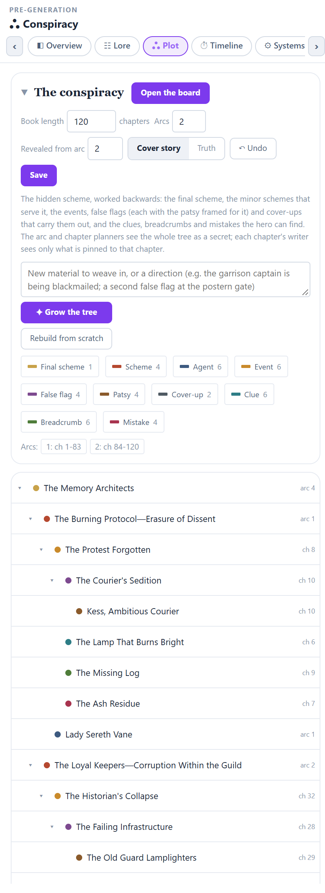
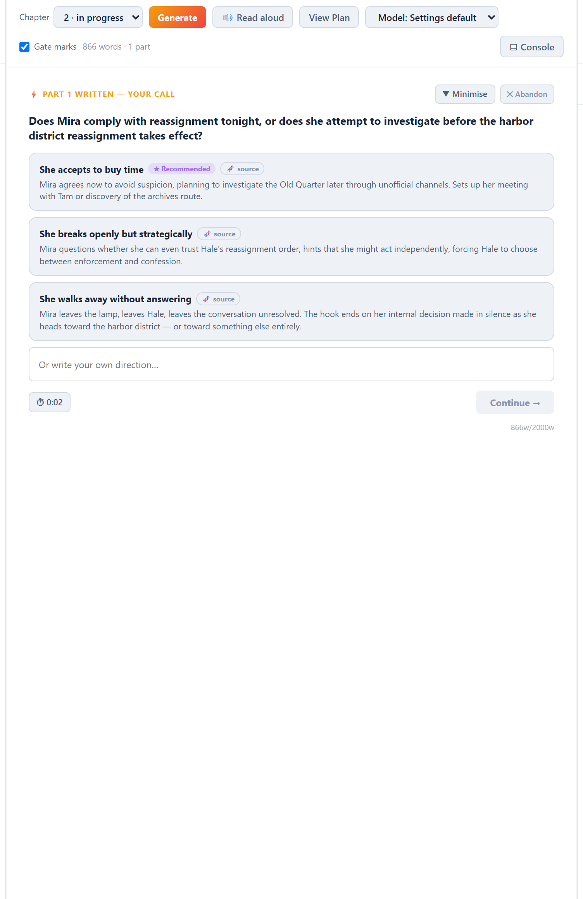
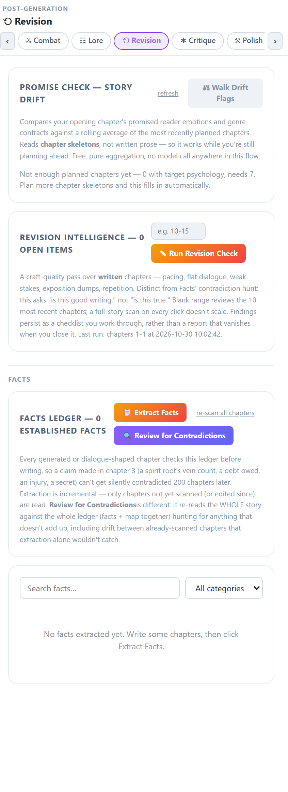
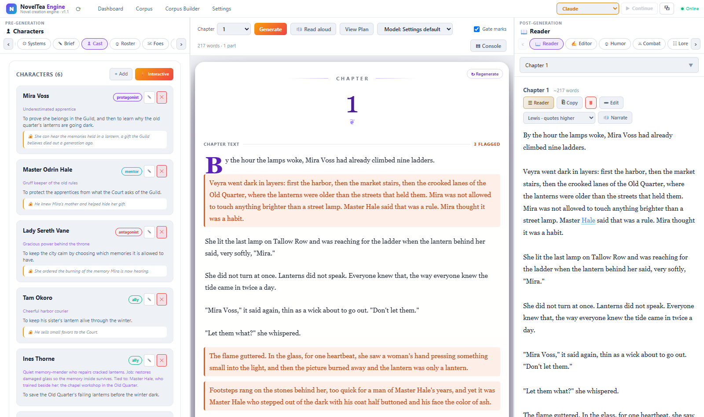

# NovelTea Engine

**The planning-first novel creation engine.**  
*Plan the secrets. Steer the story. Write the book.*

A writing studio for long web-novel serials. Instead of turning a prompt into prose, NovelTea Engine helps an author **plan** a
serial (hidden schemes and clues, power curves, arcs, timeline, lore, cast, voice) and then write chapters through an **interview**: at
each step you pick one of three directions.

It also ships the tooling to build a **reference corpus** from novels you have the right to use: per-chapter structured extraction,
rolling story summaries, a local semantic search index, and "author brains" (how a comparable author planned arcs and long secrets).
The planning tools can read that corpus as craft guidance (never to copy names or events).

**This repository contains the application only. It contains no novels, no extracted data and no keys.** The app starts with an empty
corpus; everything corpus-related lights up once you build your own.

**Copyright:** NovelTea Engine teaches structure and craft; it is not for copying books. Read [COPYRIGHT_AND_USE.md](COPYRIGHT_AND_USE.md)
for what each function does with source text and how to use it responsibly.

**How it fits together:** see the flow charts in [FLOWCHART.md](docs/FLOWCHART.md) and the illustrated [user guide](docs/GUIDE.md).

## See it first

Click **Open the demo project** on the dashboard to explore a finished example (a small fictional fantasy mystery, *The Lantern Court*:
brief, cast, systems, lore, a conspiracy tree, timeline, arcs, chapter plans and a written chapter). It ships in [`demo/`](demo) and costs
nothing to try.

**[Read the illustrated user guide](docs/GUIDE.md)**: every tab, with a picture of each, in three stages.

| 1. Pre-generation: plan | 2. Generation: write with the interview | 3. Post-generation: read, check, polish |
|---|---|---|
|  |  |  |



## What is in the app

- **Project workspace** with pre-generation tabs: Creative Brief, Author DNA (voice), Characters / Cast roster, Antagonists, Systems,
  Lore, Conspiracy tree (final scheme, schemes, clues, false flags), Timeline, Arc planner, Chapter skeletons, scene plans, Map.
- **Chapter interview** (Generate): the next prose part plus three genuinely different directions with evidence; Back, free text,
  read aloud, a house-style gate with per-paragraph marks.
- **Post-writing tools:** reader, editor, critique, revision, continuity, dialogue shaping, chapter tools.
- **Import and export:** back up or move a whole project as a `.noveltea.zip` bundle, export the manuscript as Markdown or text, and import a bundle or a `.txt`/`.md`/`.docx` manuscript.
- **Corpus tools** (optional): Corpus Builder (upload your own text, run the pipeline), extraction, merge, rolling summaries, knowledge index, author brains, Corpus Reader with local
  text-to-speech ([Kokoro](https://github.com/thewh1teagle/kokoro-onnx)). The corpus informs structure and craft only: the
  generator never splices or copies corpus text into chapters, and voice excerpts are shown to the model as a "study, do not copy"
  reference.
- Engines: Claude (API key or the Claude Code CLI on a subscription), Gemini, NVIDIA Nemotron/Kimi, and local models through Ollama.
  Add keys in **Settings**; they are stored in `~/.noveltea-engine/config.json`, never in the repository.

## Layout

The code is organised by the three stages of writing a book, in both the backend and the UI:

```
NovelTeaApp/
  backend/                      FastAPI app (python main.py -> http://127.0.0.1:7432)
    routers/
      pre_generation/           planning: conspiracy, antagonists, cast roster, lore, timeline, fights, scenes, canon, blueprints
      generation/               the chapter interview, the house-style gate, background jobs
      post_generation/          working on written chapters: versions, save, restore, pronunciation
      corpus_tools/             the optional corpus: builder, reader, wiki, author brains, pipeline health
      workspace/                projects, import/export, settings, server page, system, first-run setup
    services/                   shared helpers: local CPU engine, command-line agent
    prompts/  tests/            prompt files, pytest suite
  renderer/src/                 React + Vite UI
    components/
      pre_generation/           Brief, Arcs, Skeleton, Cast, World, Systems, Map, Voice, Humor, Combat, ...
      generation/               the Generate workspace, interview dock, gate marks, new-project wizard
      post_generation/          Reader, Editor, Revision, Critique, Facts, Assistant
      corpus/  layout/  shared/ corpus visuals, app shell, small shared pieces
    pages/                      Dashboard, Settings, Server, project view and the corpus pages
  electron/                     optional desktop CLIENT: a window onto a running server (it contains no server)
corpus/                         the corpus folder, shipped EMPTY: the pipeline scripts (extract_queue.py, merge.py, ...)
                                plus empty raw/ novels/ projects/ generated/. Everything you build lives here and is git-ignored.
demo/  docs/                    the demo project, the illustrated guide and the flow charts
```

The app uses `corpus/` in this repository by default. To keep your corpus somewhere else (another drive, a synced folder), set the
path in **Settings → Corpus Path**: the folder is created if needed, filled with `raw/ novels/ projects/ generated/` and a copy of the
pipeline scripts, and the app uses it after a restart (it is stored as `corpus_path` in `~/.noveltea-engine/config.json`).

## Install and run

Requirements: Python 3.12, Node 18+. Optional: [Ollama](https://ollama.com) with `nomic-embed-text` (semantic search and fully local
generation), the Claude Code CLI (subscription engine).

```bash
# from the repository root
python -m venv .venv
. .venv/bin/activate                                 # Windows: .venv\Scripts\activate
pip install -r requirements.txt

# backend
cd NovelTeaApp/backend
python main.py                                       # http://127.0.0.1:7432 (also serves the built UI if backend/webui exists)

# UI, in a second terminal (development)
cd NovelTeaApp/renderer
npm ci
npm run dev
```

Run the tests with `cd NovelTeaApp/backend && pip install pytest httpx && python -m pytest`. They use a throwaway home folder and corpus, never yours.

To serve the UI from the backend, run `npm run build` in `renderer/` and copy `renderer/dist` to `NovelTeaApp/backend/webui`.
`NovelTeaApp/Build-NovelTea.ps1` shows the Windows packaging steps (PyInstaller exe).

### Desktop client (optional)

The Electron app is **only a client**, like a browser window with its own title bar. It does not start, stop or configure the Python
server, has no copy of the backend, and cannot touch the corpus or any server file. Start the server first (above), then:

```bash
cd NovelTeaApp
npm ci
npm start                                       # connects to http://127.0.0.1:7432 (or the address you used last)
npm start -- --server=http://192.168.1.20:7432  # or any server address; also NOVELTEA_SERVER_URL
```

If no server answers, the app shows a small screen to type a server address (for example a PC on your network, or a Tailscale address
like `https://my-pc.my-tailnet.ts.net:8443`). The address is remembered. **Ctrl+Shift+K** brings that screen back at any time. A server
on another computer must be started with `NOVELTEA_HOST=0.0.0.0` (see "Install safely"). `npm run dist` builds an installer.

### Install safely

- **Use a virtual environment** (as above) and never `pip install` into the system Python or with `sudo`. Delete the `.venv` folder to
  remove everything it installed.
- **Read before you install.** Every dependency is listed in [requirements.txt](requirements.txt) and comes from PyPI (Python) or
  `package-lock.json` (Node, installed with `npm ci`, which uses exactly the locked versions). To freeze
  what you tested, run `pip freeze > constraints.txt` after the first install and reinstall later with `pip install -r requirements.txt -c constraints.txt`.
- **It listens on your computer only.** The server binds to `127.0.0.1` and accepts browser calls only from pages on your own machine.
  The app has no login, so do not expose it casually. To reach it from a phone or another PC, opt in explicitly:
  `NOVELTEA_HOST=0.0.0.0` (and `NOVELTEA_ALLOW_ORIGINS=https://your-address` if the page is served from another address), and only
  on a network you trust or behind a private tunnel such as Tailscale.
- **Your keys stay on your machine.** API keys you add in Settings are saved as plain JSON in `~/.noveltea-engine/config.json`, outside the
  repository (and never committed). Protect your user account, use keys with spend limits, and revoke any key you suspect.
- **Your text goes where you send it.** Chapters and prompts are sent to whichever engine you select (Claude, Gemini, NVIDIA, or a local
  Ollama model, which keeps everything on your machine). Pick a local engine for private drafts.
- **Agent tools can run commands.** The agent features can read and write files and run allow-listed commands in your project and corpus
  folders. Only point them at folders you are happy for them to change, and keep backups of work you care about.
- **Keep your corpus out of git.** `corpus/` ships empty and its data folders are ignored; check `git status` before you push a fork.
- **Updating:** read the changes first, then `pip install -U -r requirements.txt` and `npm ci`.

## Building your own corpus

The corpus is optional. Open the **Corpus Builder** page, add a novel (it creates `corpus/raw/<novel_id>/`) and upload plain-text chapters
(`ch1.txt`, `ch2.txt`, ...), only text you wrote or have the right to use. There is no downloader or scraper. Then run the pipeline from the
same page (extract, merge, rolling summary, genome) and from the **Corpus Pipeline** page (knowledge index, author brains). Everything also
works from the command line in `corpus/`:

```bash
cd corpus
python extract_v3.py --novel my_novel --start 1 --end 10        # per-chapter structured extraction
python update_rolling_summary.py --novel my_novel               # story so far
python build_knowledge_index.py my_novel                        # local semantic search (needs Ollama + nomic-embed-text)
python build_author_brain_local.py --novel my_novel             # how the author planned arcs and secrets
```

Each script's header documents its options. The scripts need the packages in `requirements.txt` and an engine configured in Settings.

## Contributing and security

See [CONTRIBUTING.md](CONTRIBUTING.md) for how to run, test and structure a change, and [SECURITY.md](SECURITY.md) to report a problem privately.

## Status

A solo project, actively developed. Expect rough edges; the extraction pipeline in particular was built around one author's setup
(Windows paths and a private-network setup). Issues and pull requests are welcome.

## License

MIT, see [LICENSE](LICENSE).
