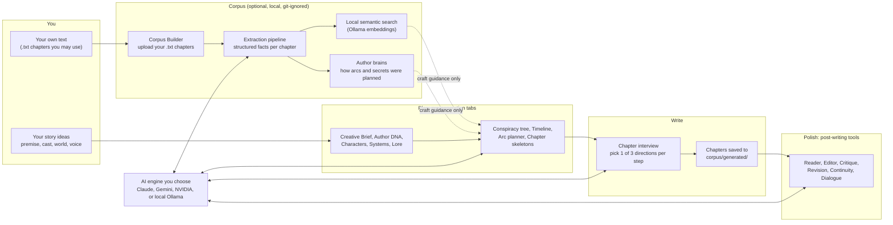
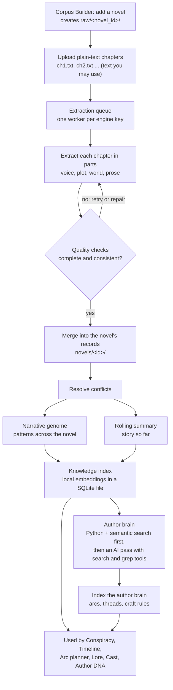
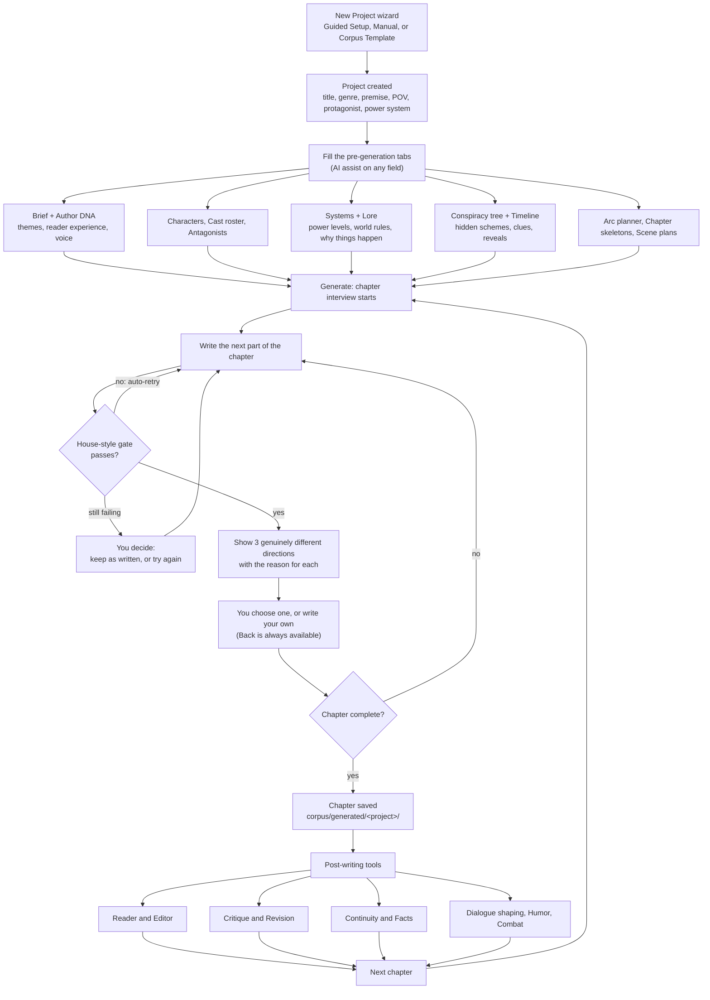
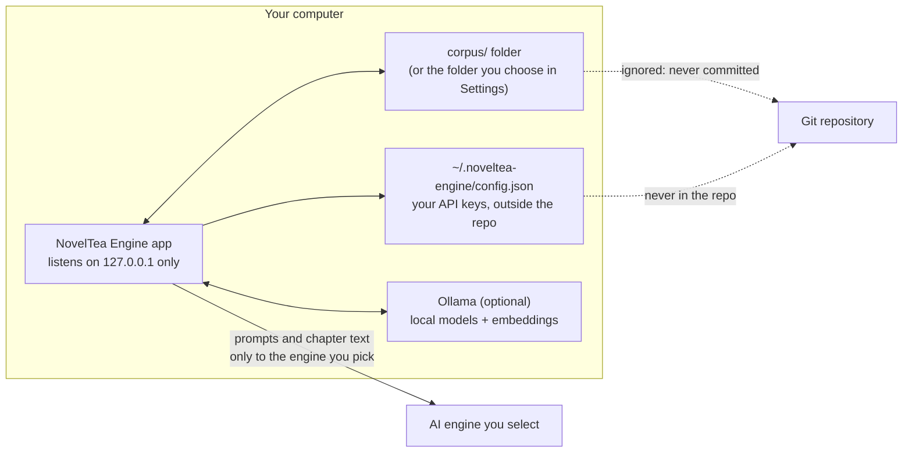

# How NovelTea Engine works: flow charts

Diagrams are [Mermaid](https://mermaid.js.org/); GitHub renders them in this page.

## 1. The big picture

The corpus never feeds text into chapters. It informs *structure and craft* (when to plant a clue, how long arcs run) and the planning
tools are told to learn the planning, never to reuse names or events. See [COPYRIGHT_AND_USE.md](../COPYRIGHT_AND_USE.md).

## 2. Building a corpus (optional)

## 3. From idea to finished chapter

## 4. Where your data and keys go

- Choose a **local Ollama model** to keep everything on your machine.
- To use the app from a phone or another PC, opt in with `NOVELTEA_HOST` (see the README) and only on a network you trust.
