# NovelTea Engine: user guide

A walk through the whole app, tab by tab, using the demo project **The Lantern Court**: a small fictional fantasy mystery written for
this guide. Every picture below is the real app showing that project. Nothing in them comes from a real novel.

**Contents**

1. [Open the demo project](#1-open-the-demo-project)
2. [The workspace in one picture](#2-the-workspace-in-one-picture)
3. [Stage 1: Pre-generation (plan the book)](#3-stage-1-pre-generation-plan-the-book)
4. [Stage 2: Generation (write it with the interview)](#4-stage-2-generation-write-it-with-the-interview)
5. [Stage 3: Post-generation (read, check, polish)](#5-stage-3-post-generation-read-check-polish)
6. [Starting your own project](#6-starting-your-own-project)
7. [Choosing an engine and keeping things private](#7-choosing-an-engine-and-keeping-things-private)
8. [The optional corpus pages](#8-the-optional-corpus-pages)
9. [The desktop client (optional)](#9-the-desktop-client-optional)

---

## 1. Open the demo project

The first screen is a short boot splash (a teapot pouring into a cup). Press **ENTER** to reach the dashboard.

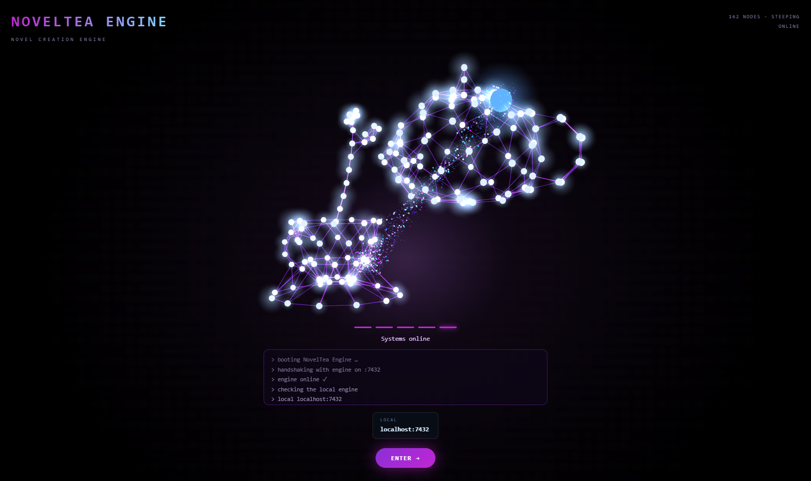

On the dashboard, click **Open the demo project**. It copies the bundled example into your workspace (`demo/the_lantern_court` in the
repository) and opens it. You can edit it freely; delete it from the dashboard any time and load it again.

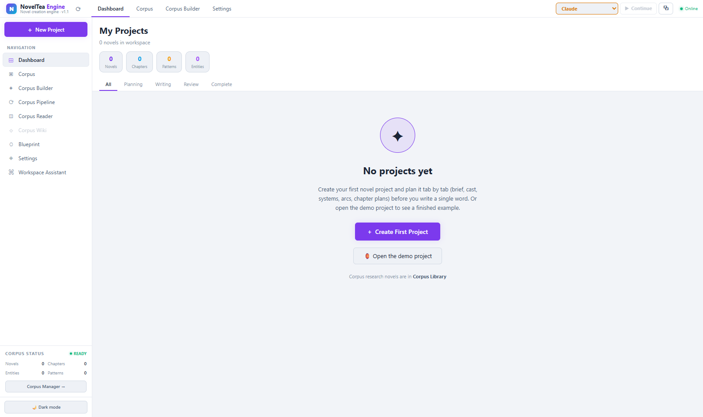

The light theme is the default. The sidebar has a button to switch to dark.

## 2. The workspace in one picture

Open a project and you get three columns that follow the order you work in:

* **Left: Pre-generation**, the planning tools (brief, cast, systems, plot, arcs, chapter plans ...).
* **Middle: Generation**, the chapter page. This is where you write.
* **Right: Post-generation**, the tools for reading, checking and polishing what you wrote.

Each side has a row of tabs along the top. On a phone the side panels slide in over the page instead of sitting beside it.

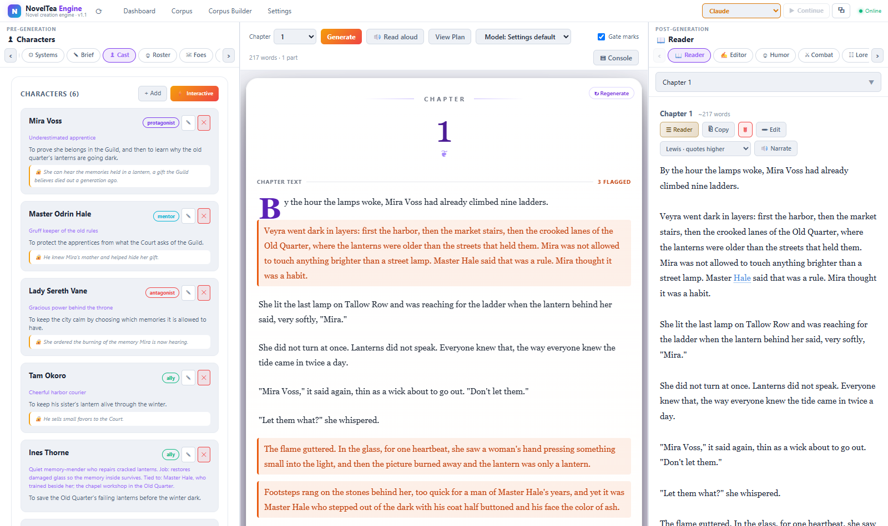

---

## 3. Stage 1: Pre-generation (plan the book)

The generator reads **all** of these tabs when it writes. The more you fill in, the more the chapters sound like your book. Fill
in what helps you and leave the rest; nothing is mandatory.

Most tabs have two ways to work: type it yourself, or press **Interactive** (the app asks you a few questions with options to choose
from, then writes the field). Anything the AI proposes is a proposal you accept or decline; nothing is saved behind your back.

### Cover

The book's front cover and title. Click **Edit cover** to pick an emoji and gradient or upload an image.

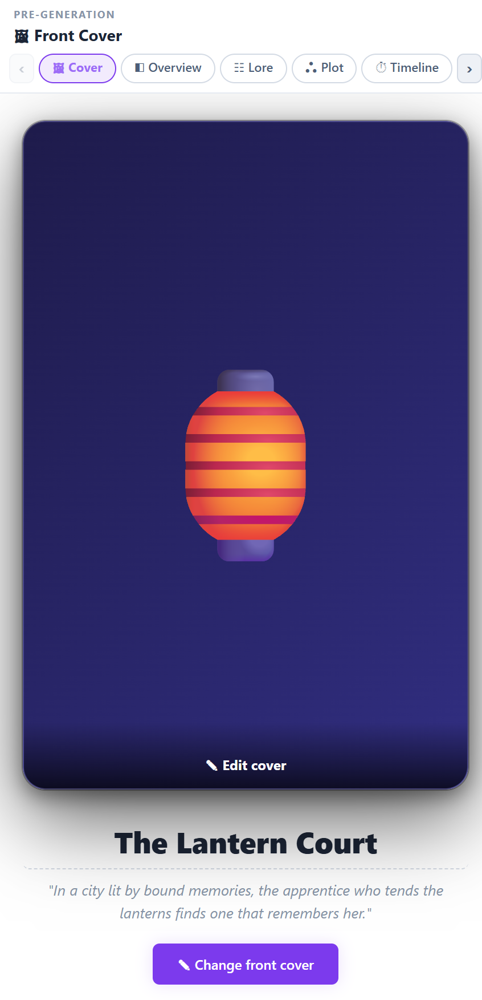

### Overview

The project at a glance: premise, genre, target length, arcs, chapters planned, and a **planning checklist** with a health score so you
can see what is still missing. The buttons jump straight to the Brief, the Arc Planner or Generate.

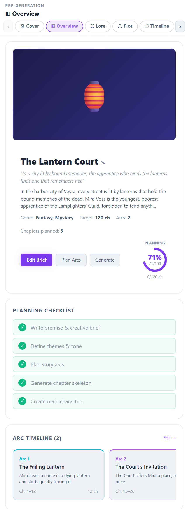

### Brief (Creative Brief)

The foundation: the **premise**, **tagline**, **themes**, **genre tags** and **reader experience** sliders (how much epicness, mystery,
comedy, romance ... you want). Every other tool refers back to this.

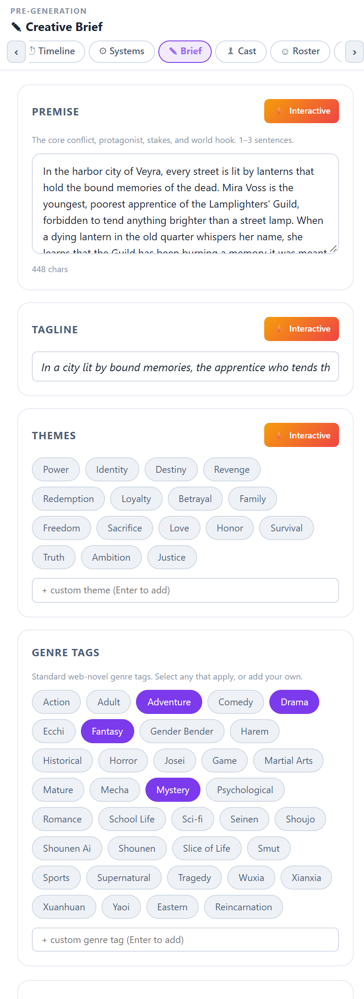

### Cast (Characters)

The people of the book: role, archetype, motivation, **secret**, faction, how they speak and banter. The secret field matters: the plot
tools use it to decide what must stay hidden from the reader.

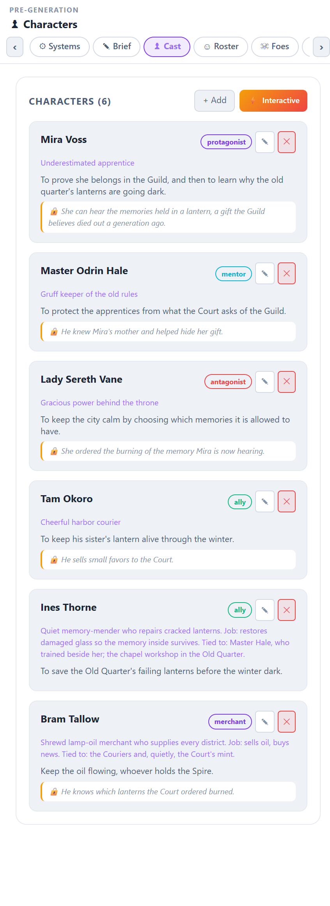

### Roster (Cast roster)

Everyone who is **not** an enemy, planned across the whole book: when each character is introduced, how long they stay on stage, their
journey and their voice. **Generate** proposes new characters for a stretch of chapters; you accept or decline each one. Two proposals are
waiting in this screenshot.

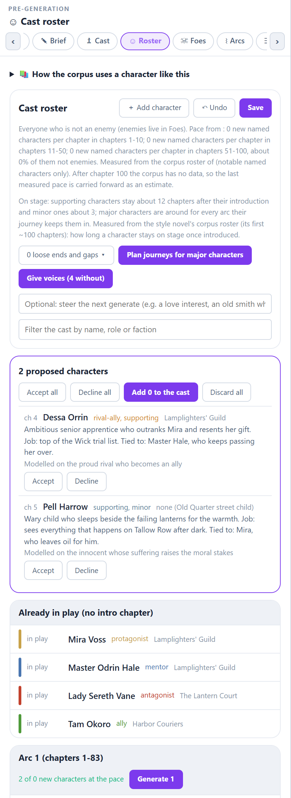

### Foes (Antagonists and obstacles)

The people and forces in the hero's way, from the petty nuisance to the hidden mastermind, in tiers: annoyance, rival, enemy, nemesis,
boss. **Foes by arc** shows who is in play in each arc and lets you fill the gaps.

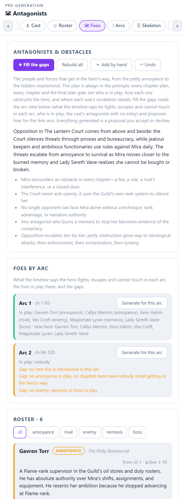

### Systems

The rules of your world's power and economy: the **power ladder** (levels, requirements, breakthroughs), techniques, weapons, factions,
races, wars, currency and more. Each section can be written by hand, generated, or pasted in from notes.

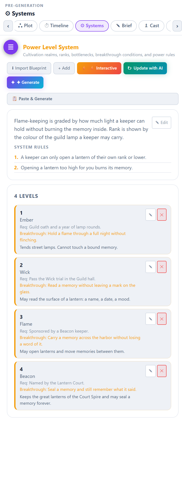

### Lore (why it happens)

The history and facts behind the world, written as background rather than plot. Entries start as **drafts**; press **Approve** and they
become canon that every other tool respects. **Suggest lore** proposes new entries. After you write a chapter, the **Lore** tab on the
right side shows that chapter's "why" cards.

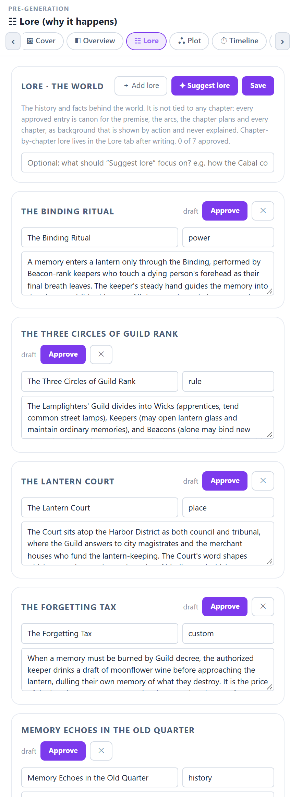

### Plot (Conspiracy)

The hidden scheme of the book, **worked backwards**: the final scheme, the minor schemes that serve it, the events, false flags (with the
patsy who is framed), cover-ups, and the clues, breadcrumbs and mistakes the hero can find. The writer only ever sees what you pin to a
chapter, so secrets do not leak early. Use **Grow the tree** to add material, **Open the board** for the big view, and the
**Cover story / Truth** switch to see what the world believes versus what is real.

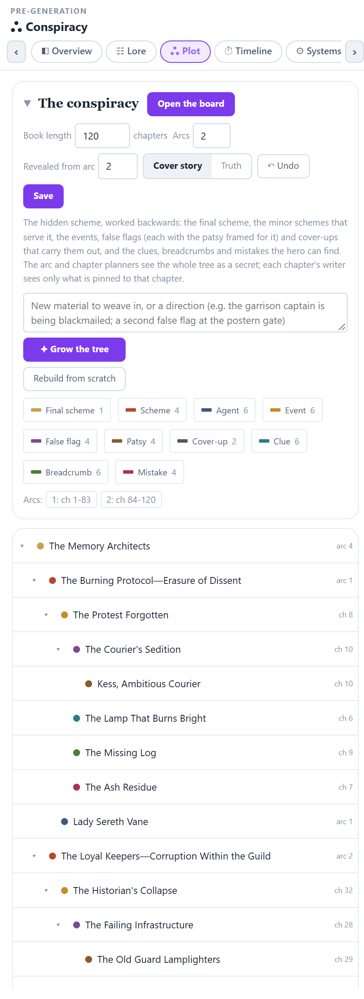

### Timeline

The book chapter by chapter **from the hero's point of view**: your events plus the "slips" the Plot tree plants. Switch between *What
she sees* and *Truth*. **Suggest** proposes events for an arc; nothing is saved until you accept and press Save.

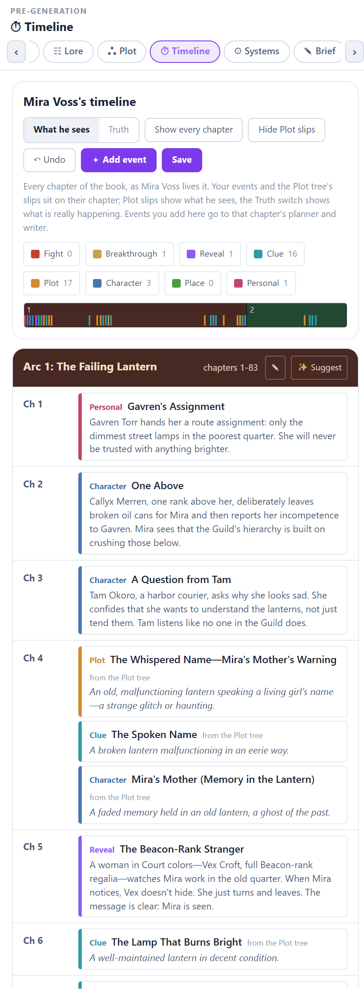

### Arcs (Arc planner)

Plan the story in arcs. Each arc has a function (setup, escalation ...), a power milestone, the tier of opponent, a tension shape and the
reveals it owes the reader. The sequential builder writes one arc at a time, seeing everything before it.

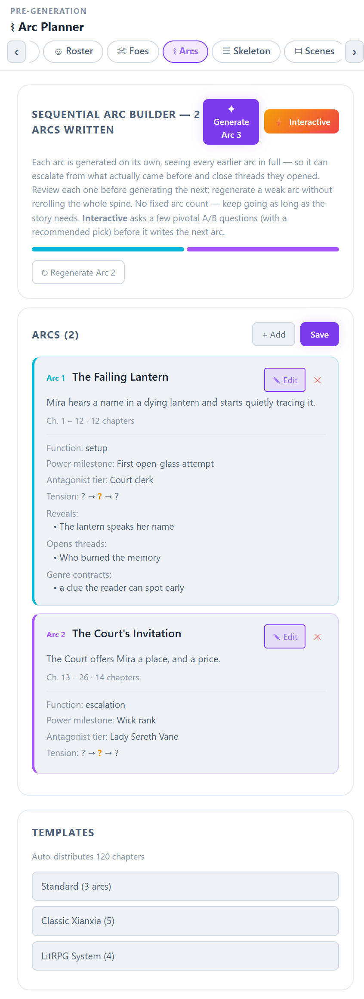

### Skeleton (Chapter skeleton)

A plan for every chapter: purpose, key event, tension, hook and its scenes with word budgets. **Round-trip validation** later measures a
written chapter against its plan ("did it build what was specified?").

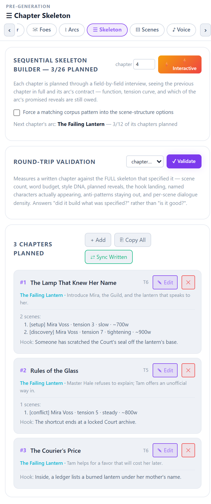

### Scenes (Scene plans)

Plan a single scene before you write it: pick a kind of scene and a word budget and the app runs a short interview, one question per beat,
with the cost of each option shown. Accepted scene cards are what the chapter writer follows.

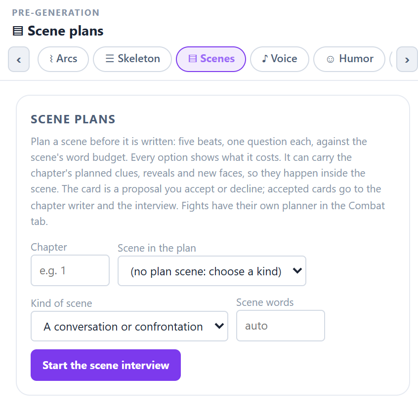

### Voice (Author DNA)

The writing profile that is injected into every arc and chapter plan: pacing, transition vocabulary, target reader emotions, tension
curve and point of view. If you have built a corpus you can seed it from a novel you admire ("Match the voice of ..."); without one, set
it by hand.

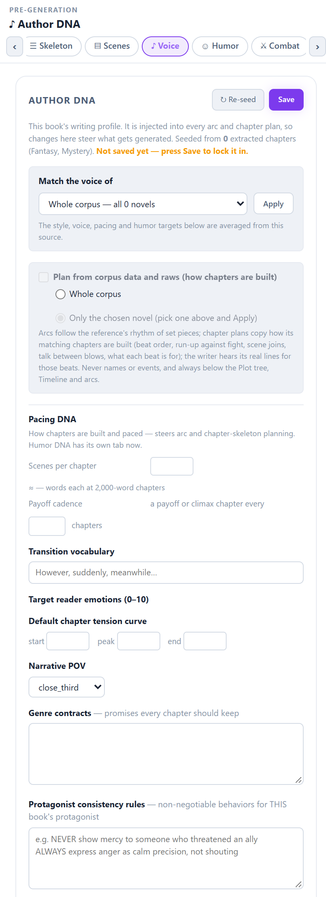

### Humor and Combat

**Humor** and **Combat** hold the planning side of comedy and fights: the DNA taken from your Author DNA, the **fight plan** (plan a
fight beat by beat against a word budget) and your own moves. They fill in as you set up the voice and write chapters. The post-generation
versions of the same tabs check what you actually wrote.

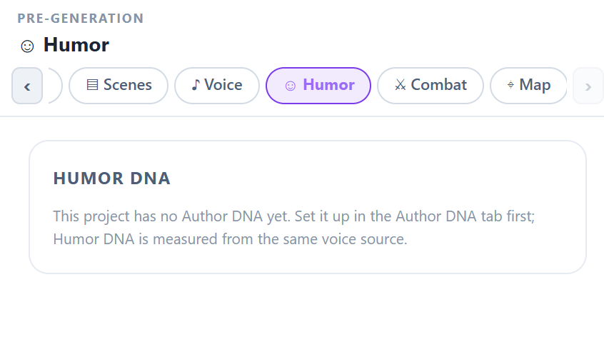 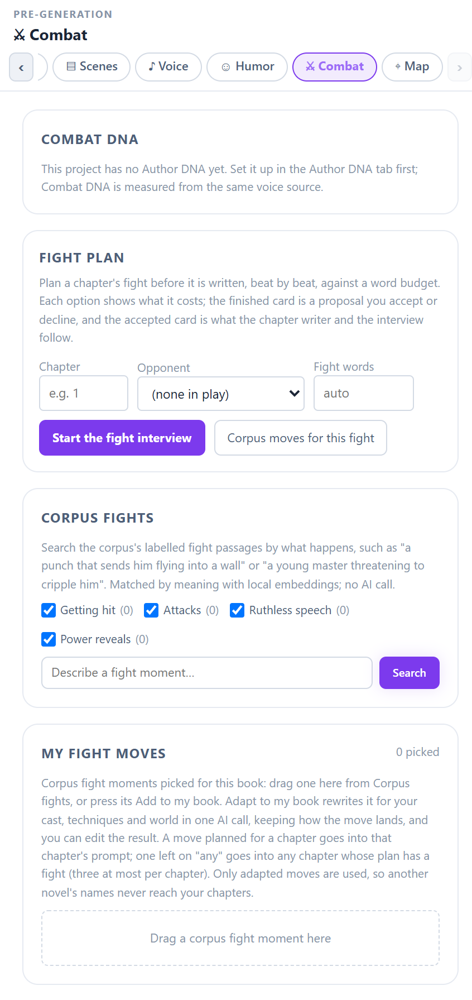

---

## 4. Stage 2: Generation (write it with the interview)

The middle column is the chapter page. Pick a chapter at the top and press **Generate**. Instead of dumping a whole chapter, the
app writes **one part at a time** and asks you where to go next.

**A blank chapter.** Parts you write appear here and are kept. A paragraph that fails the house-style gate is marked on the page so you
can fix just that paragraph.

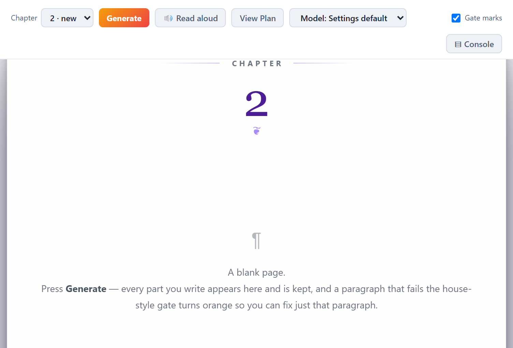

**When a part fails the gate.** Each part is checked against the house style before you see it, and failures are retried automatically. If it
still fails after two tries, the app tells you exactly why and lets you decide: **keep it as written** or **try rewriting once more**. The
failed draft stays on the page in orange so you can read it first.


**The interview.** After each part the app writes a question and **three genuinely different directions**, one marked as recommended,
each with the reason behind it. Pick one, or write your own direction in the box. **Back** goes to an earlier question, **Read aloud**
reads the part, and **Minimise** hides the interview so you can read the page.

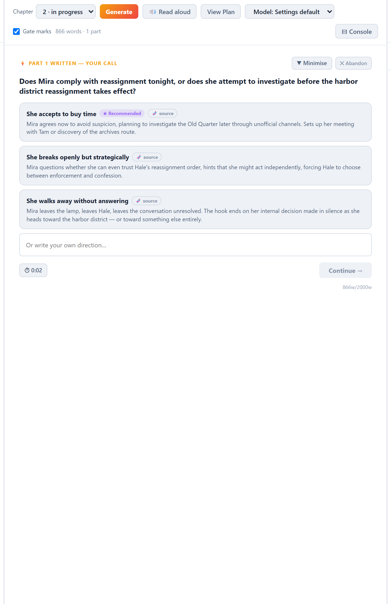

**The page with Part 1 written.** The part is on the page, ticked as having passed the gate. A small pill at the bottom reopens the interview.

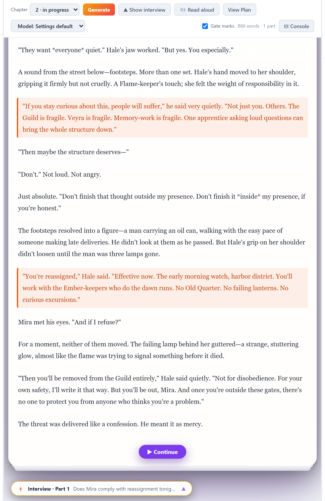

**Gate marks.** The house-style gate checks each part (for example overlong paragraphs and sentence rhythm). Parts that fail are retried
automatically; if they still fail you choose to keep them or try again. Flagged paragraphs are drawn in orange; click one to
see why, edit it, or have just that paragraph rewritten. You can also **go back to any earlier part** and answer its question again.

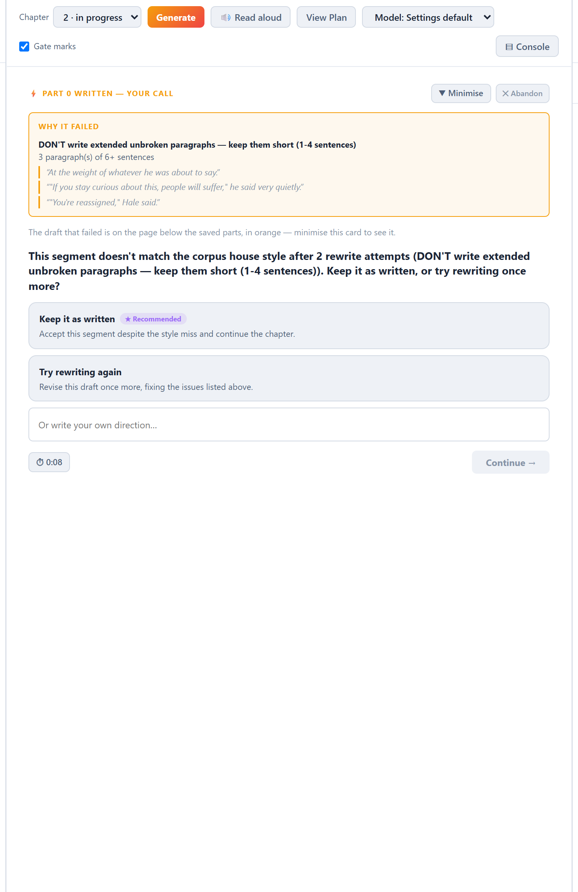

The top bar of the page also has **Read aloud**, **View Plan** (the chapter's plan from the Skeleton), a **Model** override for this
chapter and a **Console** that shows what the engine is doing.

---

## 5. Stage 3: Post-generation (read, check, polish)

### Reader

Read the chapter like a book. Copy it, edit it, or **Narrate** it with a local text-to-speech voice. Character names are highlighted.

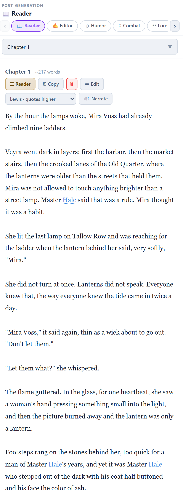

### Editor

Edit the text directly. **Shorten**, **Voice Check** (does each character still sound like themselves?) and **Voice Match** help; **Save**
keeps a version so you can go back.

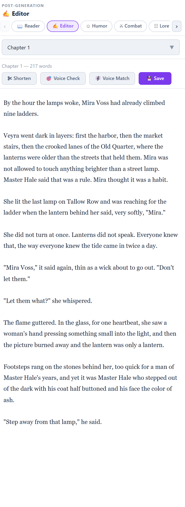

### Humor (after writing) and Combat (after writing)

**Humor** tracks running gags, what needs a payoff, face-slaps waiting to be paid back. **Combat** measures the fights you wrote against
your Combat DNA.

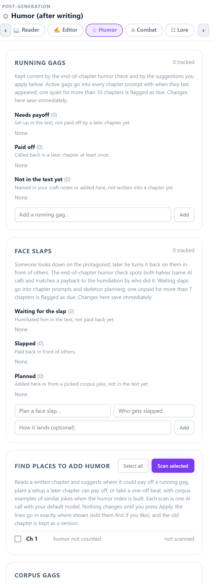 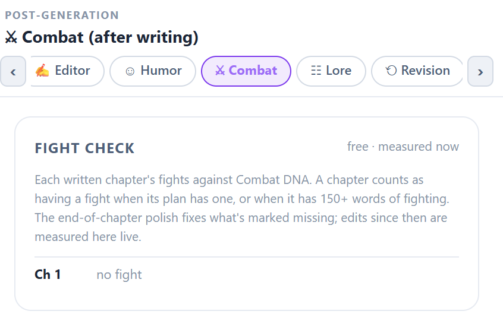

### Lore (after reading)

Read a chapter, then say what you want to understand or change. The tab shows that chapter's lore card (where, when, why events happen,
what each character knows, what the prose must not explain). **Redraft** rewrites it; changes you approve become canon.

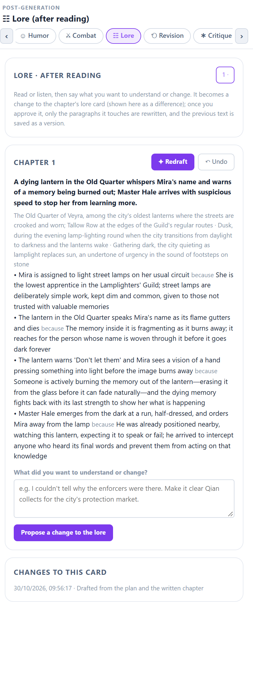

### Revision

Craft checks that do not need you to re-read everything: **promise check** (is the book still delivering what it promised?),
**revision intelligence** (pacing, flat dialogue, weak stakes, exposition dumps, repetition), and a **facts ledger** with a contradiction
check, so a detail stated in chapter 3 cannot be silently contradicted in chapter 80.

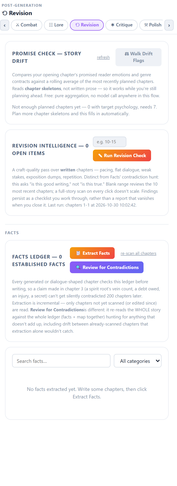

### Critique

Tell the app what you did not like about a chapter. It proposes concrete fixes, applies the one you choose, and turns your critique into a
**standing rule** that every future chapter follows. The two rules in the screenshot are examples.

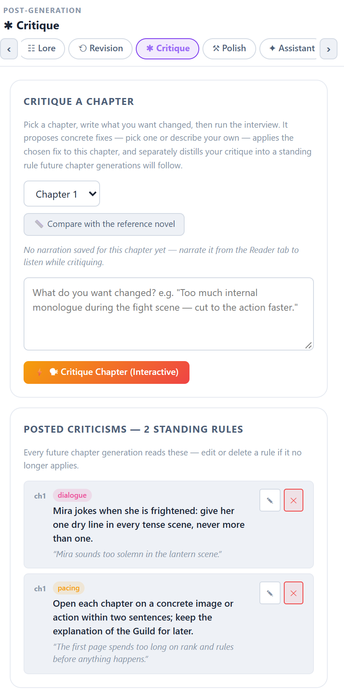

### Polish (Chapter tools)

Per-chapter tools: **Dialogue shaping** (interactive), **Enrich with Blueprint**, **Discovery** (collects the new characters, techniques
and places a chapter invented and offers them to your planning tabs) and **Corpus suggestions** (craft fixes inspired by, never copied from,
a corpus, if you have one).

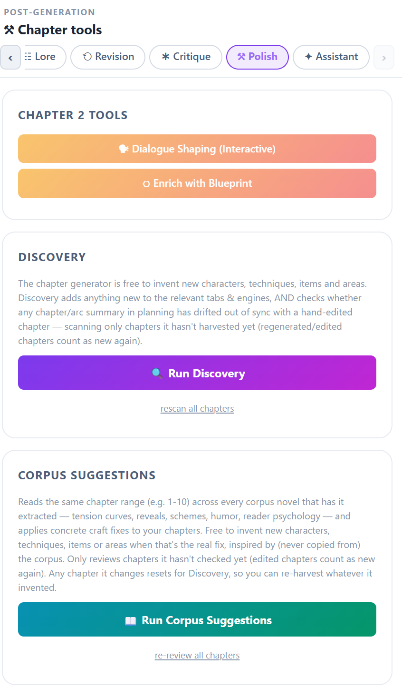

### Assistant

Ask in plain words to change anything in the project (rename the hero everywhere, add a faction, make the power levels match the world
bible). It reads and edits the whole project, and every change is snapshotted so you can undo it.

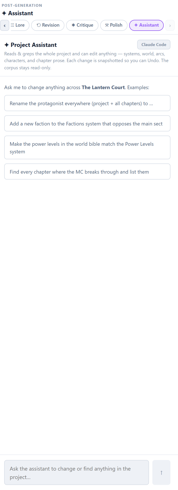

---

## 6. Starting your own project

Click **New Project** on the dashboard. Pick a setup mode:

* **Guided Setup:** answer questions about genre, story DNA, culture and inspirations; the project is created with them filled in.
* **Manual + AI assist:** create it with the basics and fill each tab yourself.
* **Corpus Template:** blend the story DNA of corpus novels into a starting template (needs a corpus, see section 8).

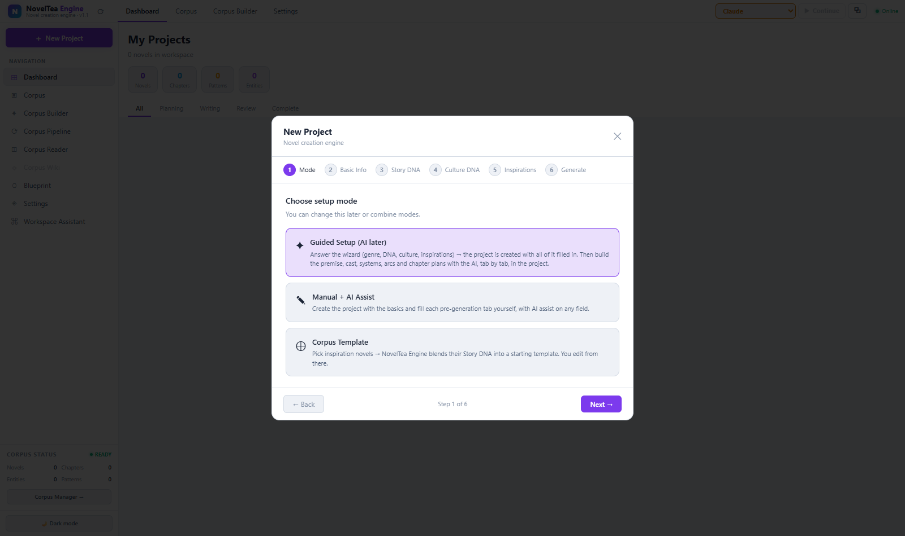

### Import and export a project

Projects are portable. A **project bundle** (`.noveltea.zip`) holds the whole project (plan, chapters and their version history, cover) and opens in
NovelTea Engine.

**Export** from three places: the small **⤓** button on a project card on the dashboard, the **Export** button on the project's **Overview** tab,
and **⤓ Manuscript** in the **Reader**. Choose the whole project as a bundle, or just the manuscript as Markdown or plain text.

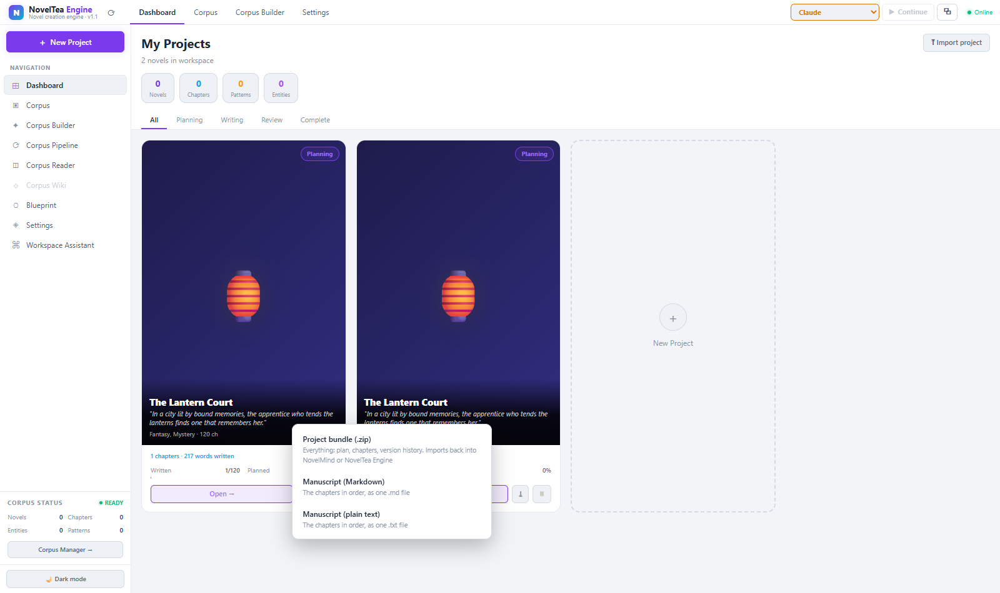

**Import** with **Import project** at the top of the dashboard. Choose a bundle, or a manuscript (`.txt`, `.md` or `.docx`, split into chapters on
"Chapter N" headings). You see what is inside first, and can rename it. It is always added as a **new** project; nothing existing is changed.

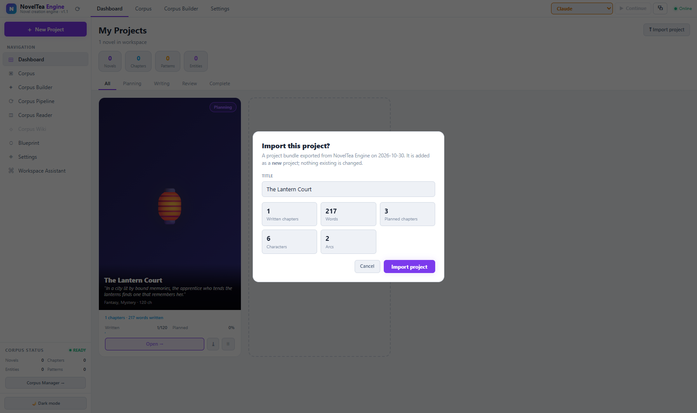

The importer treats files as untrusted: it refuses unsafe paths and links, checks the file list and checksums, ignores anything that is not part of a
project, and undoes everything if something fails part-way.

When a project is created, use the buttons on the last step to jump to the Brief, Author DNA, Characters, Systems or Arc Planner. A good order:
**Brief, Cast, Systems, Arcs, Chapter skeletons, then Generate.**

## 7. Choosing an engine and keeping things private

The engine drop-down at the top right chooses what writes your text: Claude (API key or the Claude Code subscription CLI), Gemini,
NVIDIA models, or local models through Ollama. Add keys under **Settings**; they are stored in `~/.noveltea-engine/config.json` on your
computer, never in the project. Text goes only to the engine you pick, so choose a local Ollama model if you want everything to stay on
your machine. The server listens on your computer only by default. See the README's "Install safely" section.

## 8. The optional corpus pages

The corpus is a private library of novels **you have the right to use**, analysed so the planning tools can learn structure and craft
from them (never to copy text; see [COPYRIGHT_AND_USE.md](../COPYRIGHT_AND_USE.md)). You do not need it to use the app.

* **Corpus Builder:** add a novel and upload plain-text chapters, then run extraction, merge, summaries and the genome. There is no
  scraper or downloader. The graph on this page is the teapot: each novel owns a slice of it.
* **Corpus Pipeline:** build the knowledge index and author brains (how an author planned arcs and secrets), and see what is done.
* **Corpus Reader:** read your own uploaded chapters, with read-aloud.
* **Corpus:** search your corpus by meaning ("a betrayal that shocks everyone").
* **Blueprint:** reusable reference entries (power systems, techniques ...) you can adapt into a project.

---

## 9. The desktop client (optional)

Everything above works in an ordinary browser at the server's address. If you would rather have it in its own window, the repository
includes a small **desktop client** (Electron). It is *only* a client: like a browser tab with its own title bar, it connects to a server
that is already running and has no server inside it. It cannot start or stop the server, and it cannot touch the corpus or any server file.

```bash
cd NovelTeaApp
npm ci
npm start      # connects to http://127.0.0.1:7432, or the address you used last
```

If no server answers it shows this screen, where you type the address of one (a PC on your network, or a Tailscale address). The address is
remembered, and **Ctrl+Shift+K** brings the screen back at any time.

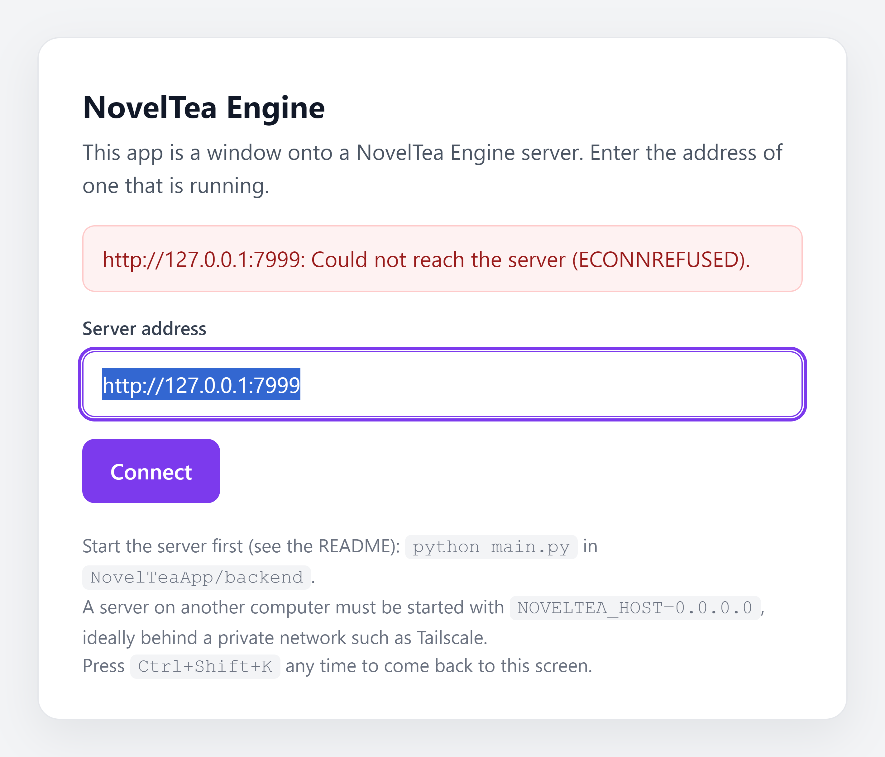

Back to the [README](../README.md).
